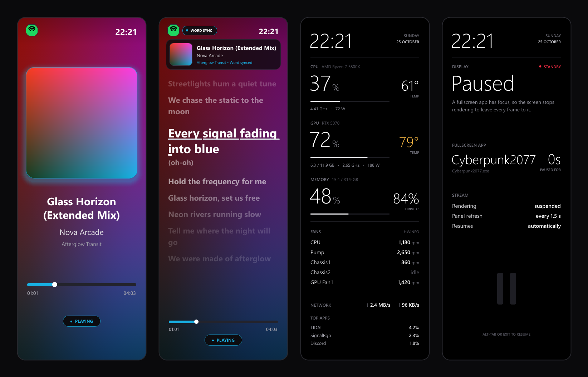
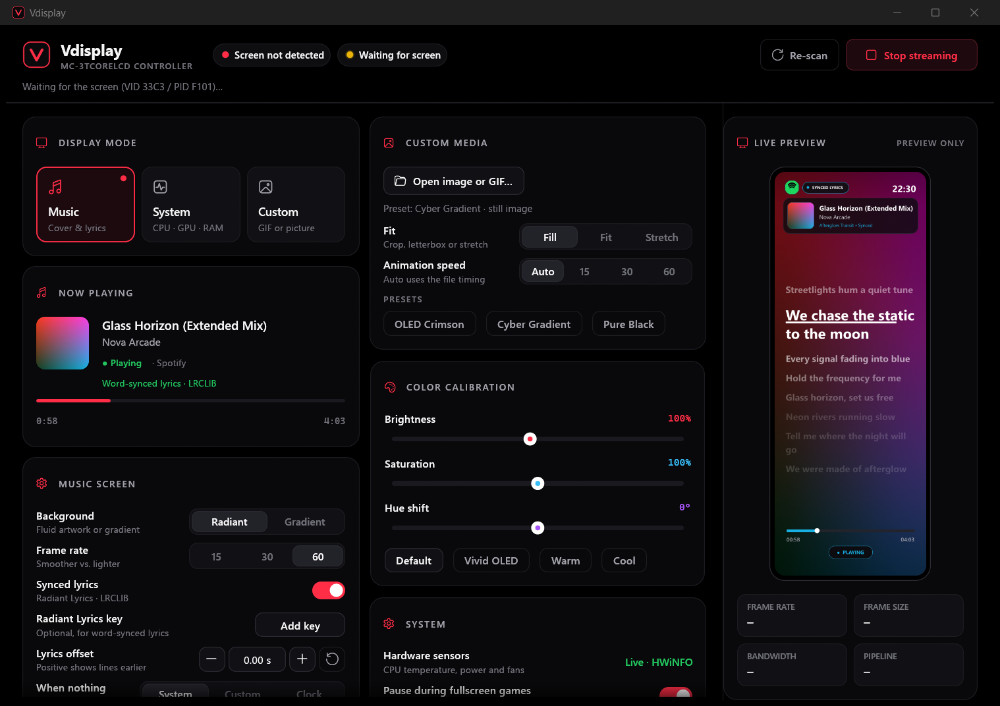
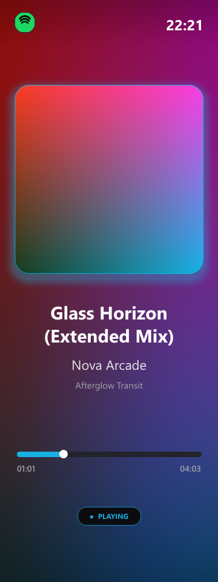
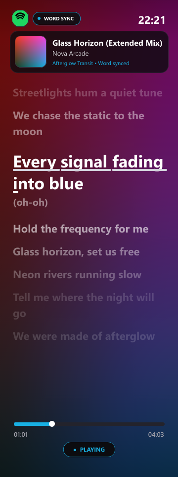
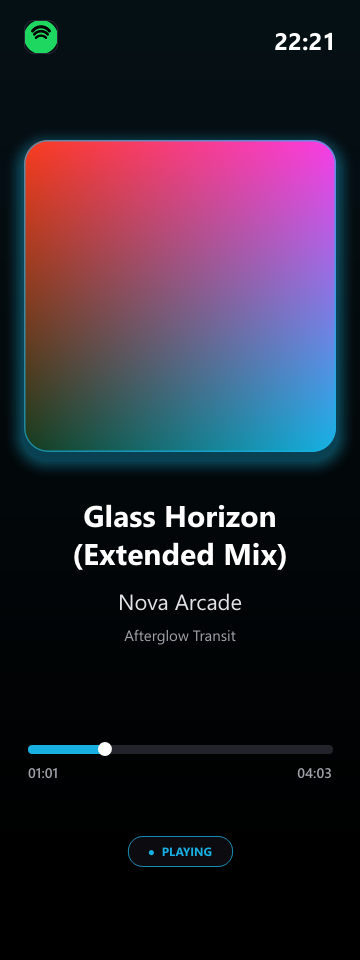
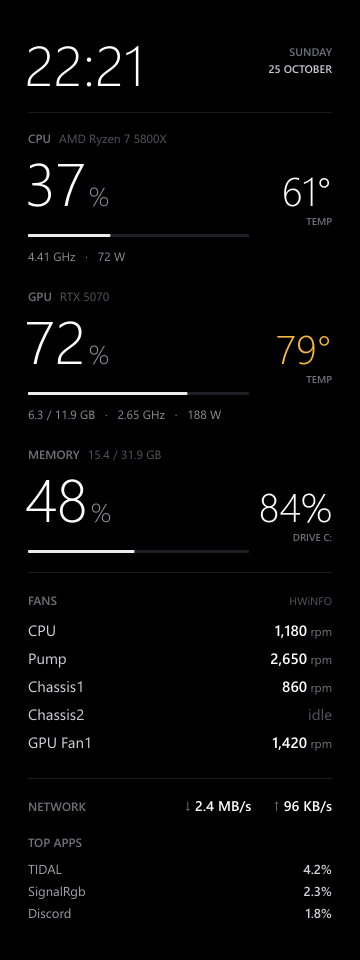
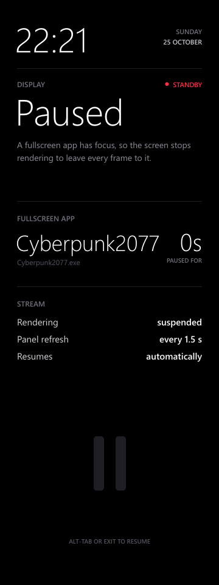

<div align="center">


# Vdisplay

**A fast, good-looking controller for the MARS GAMING MC-3TCORELCD case screen.**

Now playing with live cover art, word-synced karaoke lyrics, a clean system monitor, custom GIFs,
and automatic game mode. One small `.exe`, no runtime to install.

[](https://github.com/visiuun/vdisplay/releases/latest)
[](https://github.com/visiuun/vdisplay/actions/workflows/ci.yml)

[](LICENSE)



</div>

## Install

**Option 1: one line in PowerShell** (no admin rights; adds Start menu and desktop shortcuts)

```powershell
irm https://raw.githubusercontent.com/visiuun/vdisplay/main/install.ps1 | iex
```

Run the same line again any time to update.

**Option 2: download the exe.** Grab `Vdisplay.exe` from the
[latest release](https://github.com/visiuun/vdisplay/releases/latest) and run it from anywhere. It is
fully self-contained.

> Windows SmartScreen may warn about an unknown publisher the first time because the exe isn't
> code-signed. Click **More info → Run anyway**, or build it yourself from source (see below).

## Getting started

1. **Plug in the screen.** Vdisplay finds it on its own (USB `33C3:F101`). No driver is needed.
2. **Start Vdisplay.** If the MARS GAMING / MythCool software is running, Vdisplay closes it so it can use
   the screen. You can also do this manually under **System → Release COM port**.
3. **Pick a mode** at the top left of the window:
   - **Music**: whatever is playing in Spotify, TIDAL, Apple Music, YouTube in a browser, and so on.
   - **System**: CPU, GPU, memory, fans, network and the busiest apps.
   - **Custom**: your own GIF, WebP or picture.
4. **Optional: turn on CPU temperature and fan readings.** Open **System → Hardware sensors** and click
   **Install HWiNFO** (or **Set up HWiNFO** if you already have it). Approve the one administrator prompt
   and you're done. See [Hardware sensors](#hardware-sensors).
5. **Optional: let it run in the background.** Turn on **Launch with Windows** and **Start in the tray**.
   Closing the window keeps Vdisplay running in the tray. Use the tray icon's menu to exit.

The live preview on the right always shows exactly what the screen is showing.



## Screens

| Now playing | Karaoke lyrics | Gradient style | System monitor | Game mode | Idle clock |
|:-:|:-:|:-:|:-:|:-:|:-:|
|  |  |  |  |  |  |

- **Now playing** reads the Windows media session, so every player that shows up in the Windows volume
  flyout works. Cover art comes from the player, or from Deezer / iTunes when the player doesn't provide
  one. The background is a fluid animation made from the cover's own colors (**Radiant**) or a calm
  **Gradient**. The player's real app icon is shown in the corner.
- **Lyrics** are synced line by line from [LRCLIB](https://lrclib.net) out of the box. With a
  [Radiant Lyrics key](#synced-lyrics) you also get word-by-word karaoke timing, duets and ad-libs.
  If lyrics run early or late, adjust **Lyrics offset**.
- **System monitor** shows load, temperatures, clocks, power, VRAM, memory, drive usage, every fan, network
  speed and the top apps. Temperatures turn amber at 75° and red at 88°. NVIDIA GPU data works without any
  extra software.
- **Game mode**: when a fullscreen game or video has focus, Vdisplay stops rendering so the game gets all
  the frames, and resumes when you leave it. Turn it off under **System → Pause during fullscreen games**.
- **Idle**: when nothing is playing, choose the system monitor, your custom media, or a dim clock that
  slowly drifts to protect the panel.

## Features

- **Fast**: a full frame (render + JPEG) takes 3 to 5 ms, so 60 FPS uses a fraction of one CPU core.
  Streaming runs on its own thread and never depends on the window being open.
- **Custom media**: GIF, WebP (animated too), PNG, JPEG and BMP, with Fill, Fit or Stretch. Animations
  play at their own speed or a fixed 15 / 30 / 60 FPS.
- **Color calibration**: brightness, saturation and hue, with Vivid, Warm and Cool presets.
- **Reliable**: reconnects on its own when the screen is unplugged or the USB link stalls, and never shows
  error popups at boot. Only one copy runs at a time; starting it again just opens the window.
- **Tray menu**: start or stop streaming, switch background style, lyrics and overlay without opening
  the window.
- **Performance overlay**: optional FPS, bandwidth and latency readout on the screen itself.
- Settings are saved automatically to `%APPDATA%\Vdisplay\settings.json`.

## Hardware sensors

Windows doesn't expose CPU temperature, CPU power or fan speeds to normal apps, so Vdisplay reads them
from a sensor tool:

- **HWiNFO** (recommended, free). Click **System → Hardware sensors → Install HWiNFO**. After one
  administrator prompt, Vdisplay:
  - installs HWiNFO with winget (if needed),
  - turns on its sensor sharing and sets it to start minimized,
  - registers a small scheduled task named `Vdisplay HWiNFO`, so it can start HWiNFO later without asking
    again.

  From then on Vdisplay starts HWiNFO quietly whenever the system monitor needs it. It hides HWiNFO's tray
  icon, and restarts it when the free version's 12-hour sharing limit runs out.
- **LibreHardwareMonitor** or **OpenHardwareMonitor** also work if one of them is already running.

Without a sensor tool, the system monitor still shows everything else and marks temperatures as N/A.

## Synced lyrics

Line-synced lyrics from LRCLIB work without any setup.

For word-by-word karaoke timing, Vdisplay can use **Radiant Lyrics**. It needs your own API key: open
**Music screen → Radiant Lyrics key → Add key** and paste your token ID and token. The key is stored only
in your local settings file. Leave it empty to use LRCLIB only.

You can also set the key through the `RADIANT_LYRICS_TOKEN_ID` and `RADIANT_LYRICS_TOKEN` environment
variables, which take priority over the saved key.

## Command line

| Option | What it does |
|---|---|
| `--minimized` | Start in the tray (used by **Launch with Windows**). |
| `--render-test <folder>` | Render every screen to PNG and write a timing report. |
| `VDISPLAY_DRYRUN=1` | Run the full app without touching the screen or closing other apps. |
| `VDISPLAY_DEMO=1` | Show a built-in demo track instead of what's really playing (handy for screenshots). |

## Building from source

You need [Rust](https://rustup.rs) (stable) and the Visual Studio C++ build tools, which the Rust
installer offers to set up.

```powershell
git clone https://github.com/visiuun/vdisplay
cd vdisplay
cargo build --release
.\target\release\vdisplay.exe
```

`cargo test` runs the unit tests. Two extra network and sensor checks run with
`cargo test -- --ignored --nocapture`.

### How it works

The screen is a USB serial (CDC) device. Every frame is a 60-byte header followed by a baseline 4:2:0
JPEG of the full 360×960 image. Vdisplay draws each frame with [tiny-skia](https://github.com/RazrFalcon/tiny-skia)
and Segoe UI, encodes it with a SIMD JPEG encoder, and paces frames against a deadline. If the USB queue
backs up, it skips a frame instead of adding latency.

| Module | Role |
|---|---|
| `engine.rs` | Stream loop: render, calibrate, encode, send, pacing and reconnects |
| `device.rs` | Port discovery and the frame protocol |
| `render/` | All screens, text layout, effects and icons |
| `media.rs`, `lyrics.rs` | Windows media session, cover art, lyric fetching and parsing |
| `hw.rs`, `sensors.rs` | System stats, NVML, HWiNFO shared memory and WMI sensors |
| `gui.rs` | The desktop app (egui) and tray |

## Troubleshooting

- **"Screen not detected"**: check the USB cable, then click **Re-scan**. Close the MARS GAMING software
  if it's open.
- **Screen freezes after a while**: Vdisplay recovers stalled links on its own. If it keeps happening,
  try another USB port (preferably on the motherboard, not a front-panel hub).
- **No CPU temperature or fans**: set up HWiNFO as described above. If you run HWiNFO yourself, enable
  **Shared Memory Support** in its settings.
- **Lyrics are off by a bit**: use **Lyrics offset**. Positive values show lines earlier.

## License

Vdisplay is released under the [Creative Commons Attribution-NonCommercial 4.0](LICENSE) license.

You're free to use, modify and share it for non-commercial purposes, as long as you credit
**Vdisplay by visiuun** with a link to this repository. Commercial use is not allowed.

Vdisplay is an independent project and is not affiliated with or endorsed by MARS GAMING. HWiNFO,
Spotify, TIDAL and Apple Music are trademarks of their respective owners.
